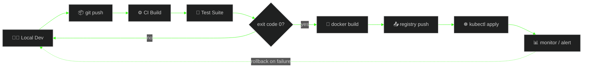

<div align="center">


<br/>

<a href="https://www.linkedin.com/in/omkar-biradar-457725245"></a>
<a href="mailto:biradaromkar.4176@gmail.com"></a>
<a href="https://leetcode.com/u/Omkar_0212/"></a>
<a href="https://github.com/dev-omkarbiradar"></a>

<br/><br/>


</div>

<br/>

## `$` neofetch

```text
                  -`                    omkar@devops-machine
                 .o+`                   ---------------------
                `ooo/                   OS: Arch Linux x86_64
               `+oooo:                  Host: Cloud-Native Infrastructure
              `+oooooo:                 Kernel: 6.6.0-shipfast
              -+oooooo+:                Uptime: 3+ years, minimal downtime
            `/:-:++oooo+:               Shell: bash 5.2 + zsh (tmux inside)
           `/++++/+++++++:              Role: DevOps Engineer / Full-Stack Dev
          `/++++++++++++++:             Location: Pune, India
         `/+++ooooooooooooo/`           CPU: Problem-Solving Core (8) @ inf GHz
        ./ooosssso++osssssso+`          Memory: 12GB Coffee / inf GB Curiosity
       .oossssso-````/ossssss+`         Packages: docker, k8s, terraform, git
      -osssssso.      :ssssssso.        WM: CI/CD Pipelines
     :osssssss/        osssso+++.       Achievements: 2x Hackathon Winner
    /ossssssss/        +ssssooo/-
  `/ossssso+/:-        -:/+osssso+-
 `+sso+:-`                 `.-/+oso:
`++:.                           `-/+/
.`                                 `/
```

<br/>

## `$` cat about.md

```yaml
name: Omkar Biradar
role: DevOps Engineer | Full-Stack Developer
location: Pune, India
mission: Ship faster, break less, automate everything
focus:
  - Designing CI/CD pipelines that ship with confidence
  - Containerizing & orchestrating cloud-native applications
  - Infrastructure as Code — repeatable, versioned, disposable
  - Living inside a terminal — tmux, vim, and a lot of grep
currently_exploring: [Kubernetes, System Design, Cloud Cost Optimization]
achievement: 🏆 Winner — TechXcelerate Hackathon @ BITS Pilani (SaaS Category)
fun_fact: I automate things twice, just to make sure the automation works
```

<br/>

## `$` systemctl status devops-pipeline.service

```text
● devops-pipeline.service - Continuous Integration & Deployment
     Loaded: loaded (/etc/systemd/system/devops-pipeline.service; enabled)
     Active: active (running) since Mon 2021-01-01

     ├─ code.service          active (running)   git commit && git push
     ├─ build.service         active (running)   GitHub Actions CI trigger
     ├─ test.service          active (running)   unit + integration suite
     ├─ containerize.service  active (running)   docker build -t app:latest .
     ├─ registry.service      active (running)   docker push → registry
     ├─ deploy.service        active (running)   kubectl apply -f deploy/
     └─ monitor.service       active (running)   prometheus + grafana alerts

     Main PID: 1337 (pipeline)
     CGroup: /system.slice/devops-pipeline.service
     Status: "All systems operational. Zero manual steps."
```

<br/>

<details>
<summary><b>$ man devops-pipeline (click to expand architecture)</b></summary>
<br/>



</details>

<br/>

## `$` pacman -Qe --grep devops

```text
aws                  24.1-1     [installed]
azure-cli            2.65-1     [installed]
gcloud-sdk            492-1     [installed]
docker                27.3-1    [installed]
kubernetes-cli         1.31-1   [installed]
terraform              1.9-1    [installed]
github-actions-runner  stable   [installed]
git                    2.46-1   [installed]
nodejs                 22.4-1   [installed]
python                 3.12-1   [installed]
postgresql             16.4-1   [installed]
mongodb                7.0-1    [installed]
redis                  7.4-1    [installed]
nginx                  1.27-1   [installed]

14 packages installed. system is up to date.
```

<div align="center">

**Cloud & Infra**
<br/>


**Containers & Orchestration**
<br/>


**CI/CD, Shell & OS**
<br/>


**Backend & APIs**
<br/>


**Databases**
<br/>


**Frontend**
<br/>


</div>

<br/>


## `$` ls -la ~/projects/

```text
drwxr-xr-x  omkar devops  4.0K  ~/projects/surakshit/          # community safety platform
drwxr-xr-x  omkar devops  4.0K  ~/projects/samku-cms/          # EV management system
drwxr-xr-x  omkar devops  4.0K  ~/projects/samku-services/     # vehicle service platform
```

<br/>

<div align="center">
<table>
<tr>
<td width="33%" valign="top">

**`./surakshit`** 🛡️
<br/>Community Safety Platform

`React` `Node.js` `Vercel`

[](https://surakshit-three.vercel.app/)

</td>
<td width="33%" valign="top">

**`./samku-cms`** ⚡
<br/>EV Management System

`Full-Stack CMS` `Cloud`

[](https://samku-cms.vercel.app)

</td>
<td width="33%" valign="top">

**`./samku-services`** 🚗
<br/>Vehicle Service Platform

`React` `Production`

[](https://samkueservices.com)

</td>
</tr>
</table>
</div>

<br/>


## `$` htop --stats github

<div align="center">


</div>

<br/>

<div align="center">

### `$` cat contribution-grid.log

<picture>
  <source media="(prefers-color-scheme: dark)" srcset="https://raw.githubusercontent.com/dev-omkarbiradar/dev-omkarbiradar/output/github-contribution-grid-snake-dark.svg">
  
</picture>

<sub>requires a one-time GitHub Actions workflow in this repo — ask and I'll generate it</sub>

</div>

<br/>

<div align="center">


<br/><br/>

**`root@omkar-devops:~$` automate today, so tomorrow deploys itself.**


</div>
