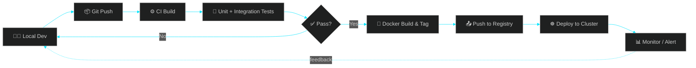

<!-- ==================== HERO BANNER ==================== -->
<div align="center">


<br/>

<a href="https://www.linkedin.com/in/omkar-biradar-457725245"></a>
<a href="mailto:biradaromkar.4176@gmail.com"></a>
<a href="https://leetcode.com/u/Omkar_0212/"></a>
<a href="https://github.com/dev-omkarbiradar"></a>

<br/><br/>


</div>

<br/>

<!-- ==================== ABOUT ==================== -->
## 🧭 `whoami`

```yaml
name: Omkar Biradar
role: DevOps Engineer | Full-Stack Developer
location: Pune, India
mission: Ship faster, break less, automate everything
focus:
  - Designing CI/CD pipelines that ship with confidence
  - Containerizing & orchestrating cloud-native applications
  - Infrastructure as Code — repeatable, versioned, disposable
  - Bridging "it works on my machine" and production
currently_exploring: [Kubernetes, System Design, Cloud Cost Optimization]
achievement: 🏆 Winner — TechXcelerate Hackathon @ BITS Pilani (SaaS Category)
fun_fact: I automate things twice, just to make sure the automation works ⚙️
```

<br/>

<!-- ==================== CI/CD PIPELINE BANNER ==================== -->
## ⚙️ CI/CD Pipeline — How I Ship Code

<div align="center">


&nbsp;➡️&nbsp;

&nbsp;➡️&nbsp;

&nbsp;➡️&nbsp;


<br/><br/>


&nbsp;➡️&nbsp;

&nbsp;➡️&nbsp;

&nbsp;➡️&nbsp;


</div>

<br/>

<details>
<summary><b>📐 View Pipeline Architecture (click to expand)</b></summary>
<br/>



</details>

<br/>

<!-- ==================== TECH STACK ==================== -->
## 🛠️ Tech Arsenal

<details open>
<summary><b>☁️ Cloud & Infrastructure</b></summary>
<br/>
<div align="center">

</div>
</details>

<details open>
<summary><b>🐳 Containers & Orchestration</b></summary>
<br/>
<div align="center">

</div>
</details>

<details open>
<summary><b>🔧 CI/CD & Automation</b></summary>
<br/>
<div align="center">

</div>
</details>

<details>
<summary><b>⚙️ Backend & APIs</b></summary>
<br/>
<div align="center">

</div>
</details>

<details>
<summary><b>🗄️ Databases</b></summary>
<br/>
<div align="center">

</div>
</details>

<details>
<summary><b>🎨 Frontend</b></summary>
<br/>
<div align="center">

</div>
</details>

<br/>


<!-- ==================== FEATURED PROJECTS ==================== -->
## 🚀 Featured Builds

<div align="center">
<table>
<tr>
<td width="33%" align="center">

### 🛡️ SURAKSHIT
**Community Safety Platform**

`React` `Node.js` `Vercel`

[](https://surakshit-three.vercel.app/)

</td>
<td width="33%" align="center">

### ⚡ SAMKU
**EV Management System**

`Full-Stack CMS` `Cloud`

[](https://samku-cms.vercel.app)

</td>
<td width="33%" align="center">

### 🚗 SAMKU Services
**Vehicle Service Platform**

`React` `Production`

[](https://samkueservices.com)

</td>
</tr>
</table>
</div>

<br/>


<!-- ==================== GITHUB STATS ==================== -->
## 📊 Metrics Dashboard

<div align="center">


</div>

<br/>

<!-- ==================== CONTRIBUTION SNAKE ==================== -->
<div align="center">

### 🐍 Contribution Grid

<picture>
  <source media="(prefers-color-scheme: dark)" srcset="https://raw.githubusercontent.com/dev-omkarbiradar/dev-omkarbiradar/output/github-contribution-grid-snake-dark.svg">
  
</picture>

<sub>⚙️ Requires a one-time GitHub Actions workflow in this repo — ask me and I'll generate it</sub>

</div>

<br/>

<!-- ==================== FOOTER ==================== -->
<div align="center">


<br/><br/>

**✨ Automating today, so tomorrow deploys itself. ✨**


</div>
