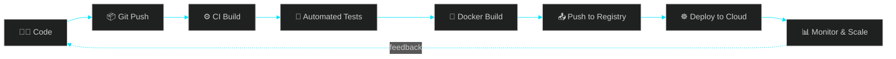

<!-- ==================== HEADER / HERO ==================== -->
<div align="center">


<br/>

<a href="https://www.linkedin.com/in/omkar-biradar-457725245">
  
</a>
<a href="mailto:biradaromkar.4176@gmail.com">
  
</a>
<a href="https://leetcode.com/u/Omkar_0212/">
  
</a>
<a href="https://github.com/dev-omkarbiradar">
  
</a>

</div>

<br/>

<!-- ==================== ABOUT ==================== -->
## 🧭 `whoami`

```yaml
name: Omkar Biradar
role: DevOps Engineer | Full-Stack Developer
location: Pune, India
focus:
  - Building CI/CD pipelines that ship with confidence
  - Containerizing & orchestrating cloud-native applications
  - Infrastructure as Code — repeatable, versioned, disposable
  - Bridging the gap between "it works on my machine" and production
currently_exploring: [System Design, Kubernetes, Cloud Cost Optimization]
achievement: 🏆 Winner — TechXcelerate Hackathon @ BITS Pilani (SaaS Category)
fun_fact: I automate things twice, just to make sure automation works ⚙️
```

<br/>

<!-- ==================== DEVOPS PIPELINE VISUAL ==================== -->
## 🔄 My DevOps Workflow

<div align="center">



</div>

<br/>

<!-- ==================== TECH STACK ==================== -->
## 🛠️ Tech Arsenal

<div align="center">

**☁️ Cloud & Infrastructure**
<br/>


**🐳 Containers & Orchestration**
<br/>


**🔧 CI/CD & Automation**
<br/>


**⚙️ Backend & APIs**
<br/>


**🗄️ Databases**
<br/>


**🎨 Frontend**
<br/>


</div>

<br/>

<!-- ==================== FEATURED PROJECTS ==================== -->
## 🚀 Featured Builds

<div align="center">

<table>
<tr>
<td width="33%" align="center">

### 🛡️ SURAKSHIT
**Community Safety Platform**

`React` · `Node.js` · `Deployed on Vercel`

[](https://surakshit-three.vercel.app/)

</td>
<td width="33%" align="center">

### ⚡ SAMKU
**EV Management System**

`Full-Stack CMS` · `Cloud Deployment`

[](https://samku-cms.vercel.app)

</td>
<td width="33%" align="center">

### 🚗 SAMKU Services
**Vehicle Service Platform**

`React` · `Production Deployment`

[](https://samkueservices.com)

</td>
</tr>
</table>

</div>

<br/>

<!-- ==================== GITHUB STATS ==================== -->
## 📊 Metrics Dashboard

<div align="center">


</div>

<br/>

<!-- ==================== CONTRIBUTION SNAKE ==================== -->
<div align="center">

### 🐍 Contribution Grid

<picture>
  <source media="(prefers-color-scheme: dark)" srcset="https://raw.githubusercontent.com/dev-omkarbiradar/dev-omkarbiradar/output/github-contribution-grid-snake-dark.svg">
  
</picture>

<sub>⚙️ Generated via a GitHub Actions workflow — see setup note below</sub>

</div>

<br/>

<!-- ==================== FOOTER ==================== -->
<div align="center">


**✨ Automating today, so tomorrow deploys itself. ✨**


</div>
